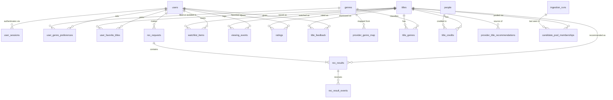

# Data Model

**Status:** Draft for review · **Last updated:** 2026-10-30

This document covers the database conventions, the v1 schema by milestone, its constraints and indexes, the user–title state rules, and deletion. The decision to keep separate relationship tables is in [ADR-0008](../adr/0008-separate-user-title-relationship-tables.md), and the rating model is in [ADR-0009](../adr/0009-ratings-and-not-for-me.md).

## 1. Conventions

| Convention | Rule | Why |
|---|---|---|
| Primary keys | `bigint GENERATED ALWAYS AS IDENTITY` surrogate keys. Association tables use composite natural PKs | Simple and compact. User IDs never appear in URLs (`/api/me/...`), so enumeration isn't a concern |
| External identity | Provider IDs are stored as data, never used as our PKs. TMDB IDs are only unique **per media type** | Lets us change providers. A movie and a TV show can share a TMDB ID |
| Timestamps | `timestamptz`, UTC, `created_at`/`updated_at` on mutable rows | Unambiguous |
| Enum-like columns | `text` + `CHECK (col IN (...))` (SQLAlchemy `native_enum=False`) | Native PG enums are awkward to change in Alembic migrations |
| `jsonb` | Only for recommendation request context, score breakdowns, reasons, and ingestion run params and counts | Their shape evolves with `engine_version`, and we rarely filter on them. Everything relational stays relational |
| Constraint names | SQLAlchemy `MetaData(naming_convention=...)` for pk/fk/uq/ck/ix | Stable, predictable names in Alembic migrations |
| FKs from user-owned rows to `users` | `ON DELETE CASCADE` | Account deletion is a single `DELETE` |
| FKs to `titles` from user data | `ON DELETE RESTRICT` | Catalog rows that users reference are never deleted. Missing provider records are flagged instead |
| Migrations | Alembic. Autogenerate output is a **draft** and is reviewed by hand. One migration per coherent change | Autogenerate misses or garbles constraints, server defaults and data migrations |
| Tests | Run on real PostgreSQL | We rely on CHECKs, partial behaviour, `ON CONFLICT` and `jsonb` |

## 2. Entity-relationship diagram (v1, through M4)



`provider_title_recommendations` targets are stored as provider identifiers, **not** as FKs. They're resolved to local titles by joining on the `titles` unique key (§3.2).

## 3. Tables by module

Each heading gives the milestone in which the table is introduced. Columns marked *(nullable)* are optional; everything else is `NOT NULL`.

### 3.1 Identity (M1)

**`users`**
| Column | Type | Notes |
|---|---|---|
| id | bigint identity | PK |
| email | text | Stored normalized (trimmed, lowercased). **UNIQUE** |
| password_hash | text | Argon2id encoded hash |
| display_name | text *(nullable)* | |
| created_at, updated_at | timestamptz | |

**`user_sessions`**
| Column | Type | Notes |
|---|---|---|
| id | bigint identity | PK |
| user_id | bigint | FK → users **CASCADE**. Indexed |
| token_hash | bytea | SHA-256 of the session token. **UNIQUE**. `CHECK (octet_length(token_hash) = 32)` |
| created_at | timestamptz | |
| expires_at | timestamptz | Absolute expiry (initial value: created_at + 30 days). No sliding expiry |
| revoked_at | timestamptz *(nullable)* | Set on logout or revocation |

No IP address, user agent or `last_seen_at` is stored. That's less personal data, and read requests never write ([ADR-0007](../adr/0007-session-auth-and-csrf.md)). Expired or revoked rows are deleted by a later cleanup command. They're harmless meanwhile, because lookups check `expires_at` and `revoked_at`.

### 3.2 Catalog (M2)

**`titles`**
| Column | Type | Notes |
|---|---|---|
| id | bigint identity | PK, our stable internal ID used in URLs |
| provider | text | `CHECK IN ('tmdb')` |
| media_type | text | `CHECK IN ('movie','tv')` |
| provider_id | integer | TMDB ID |
| imdb_id | text *(nullable)* | |
| name, original_name | text / text *(nullable)* | |
| overview | text *(nullable)* | |
| original_language | text *(nullable)* | ISO 639-1 |
| release_date | date *(nullable)* | Movie release date / TV first air date |
| runtime_minutes | smallint *(nullable)* | Movies: runtime. TV: typical episode runtime when known. `CHECK (runtime_minutes > 0)` |
| number_of_seasons | smallint *(nullable)* | `CHECK (media_type = 'tv' OR number_of_seasons IS NULL)` |
| poster_path, backdrop_path | text *(nullable)* | Paths only. URLs are built from configuration |
| popularity | real *(nullable)* | Provider popularity metric |
| vote_average | real *(nullable)* | 0–10 |
| vote_count | integer *(nullable)* | |
| adult | boolean | Default false |
| detail_level | text | `CHECK IN ('summary','full')` |
| provider_status | text | `CHECK IN ('active','missing')`. Default `active` |
| first_ingested_at | timestamptz | When the row was first created by any path |
| summary_synced_at | timestamptz | Last time list or summary fields were written |
| details_synced_at | timestamptz *(nullable)* | Last successful full hydration. `CHECK (detail_level = 'summary' OR details_synced_at IS NOT NULL)` |
| sync_error_count | integer | Default 0. Reset on successful hydration |
| last_sync_error, last_sync_error_at | text / timestamptz *(nullable)* | Short error description, no secrets |

Constraints and indexes: **`UNIQUE (provider, media_type, provider_id)`**, which is the idempotency key for every upsert. Index on `details_synced_at` for staleness scans.

**`genres`**: the internal taxonomy (see [catalog-ingestion.md §4.2](catalog-ingestion.md#42-internal-genre-taxonomy)).
| Column | Type | Notes |
|---|---|---|
| id | bigint identity | PK |
| slug | text | **UNIQUE**, e.g. `science-fiction` |
| name | text | Display name |

**`provider_genre_map`**
| Column | Type | Notes |
|---|---|---|
| provider, media_type, provider_genre_id | text, text, integer | |
| genre_id | bigint | FK → genres |
| | | **PK (provider, media_type, provider_genre_id, genre_id)**. One provider genre may map to several internal genres (TV "Sci-Fi & Fantasy" → science-fiction + fantasy) |

**`title_genres`**
| Column | Type | Notes |
|---|---|---|
| title_id | bigint | FK → titles **CASCADE** |
| genre_id | bigint | FK → genres **RESTRICT** |
| position | smallint | Provider order, **for display only**. It is *not* used as a "primary genre" for ranking or diversity ([recommendation-engine.md §8](recommendation-engine.md#8-stage-4-ranking-and-diversity)) |
| | | **PK (title_id, genre_id)**. Index on `(genre_id, title_id)` |

**`people`**: `id` PK, `provider`, `provider_id`, `name`, `profile_path` *(nullable)*, **`UNIQUE (provider, provider_id)`**.

**`title_credits`**
| Column | Type | Notes |
|---|---|---|
| id | bigint identity | PK |
| title_id | bigint | FK → titles **CASCADE**. Indexed |
| person_id | bigint | FK → people **RESTRICT** |
| role | text | `CHECK IN ('cast','director','creator','writer')` |
| character_name | text *(nullable)* | |
| credit_order | smallint | |

Credits are **replaced wholesale** on each hydration (delete + insert inside the title's transaction), so no natural unique key is needed. We store the top 10 cast plus directors (movies) or creators (TV). That's enough for FR-04 and keeps volume small.

**`provider_title_recommendations`**: TMDB's per-title recommendation list, stored for the `favorite_neighbor` signal.
| Column | Type | Notes |
|---|---|---|
| source_title_id | bigint | FK → titles **CASCADE** |
| provider | text | `'tmdb'`. Preserves where the relationship came from |
| target_media_type | text | |
| target_provider_id | integer | Provider ID of the recommended title. **Not an FK** |
| provider_rank | smallint | 1-based position in the provider's list. `CHECK (provider_rank >= 1)` |
| fetched_at | timestamptz | |
| ingestion_run_id | bigint *(nullable)* | FK → ingestion_runs. NULL when written by API read-through |
| | | **PK (source_title_id, provider, target_media_type, target_provider_id)**. Index on `(provider, target_media_type, target_provider_id)` |

Why targets aren't FKs:
- Many recommended titles aren't in our catalog, and creating summary rows for all of them would bloat the catalog with titles we can't recommend.
- Targets are resolved at query time with a join on `titles (provider, media_type, provider_id)` plus the candidate-pool predicate (§4).
- Unresolved targets are kept, because they drive the coverage metric in `report` and future pool expansion (E9).
- The whole list for a source title is replaced on each hydration.

**`ingestion_runs`**
| Column | Type | Notes |
|---|---|---|
| id | bigint identity | PK |
| command | text | `CHECK IN ('ingest','refresh')` |
| seed_plan_version | text *(nullable)* | e.g. `starter-v1` |
| params | jsonb | CLI flags as executed |
| status | text | `CHECK IN ('running','succeeded','partial','failed')` |
| counts | jsonb | discovered, inserted, updated, hydrated, failed, missing, requests |
| started_at, finished_at | timestamptz / timestamptz *(nullable)* | |
| error_summary | text *(nullable)* | |

**`candidate_pool_memberships`**: why a title is in the pool.
| Column | Type | Notes |
|---|---|---|
| title_id | bigint | FK → titles **CASCADE** |
| source_key | text | Stable seed-source key, e.g. `movie:discover:genre=science-fiction` |
| source_rank | integer | Position within that source's results |
| first_seen_run_id, last_seen_run_id | bigint | FK → ingestion_runs |
| | | **PK (title_id, source_key)**. Index on `source_key` |

### 3.3 Profile (M3)

**`user_genre_preferences`**: `user_id` FK → users **CASCADE**, `genre_id` FK → genres, `stance` `CHECK IN ('like','avoid')`, `created_at`. **PK (user_id, genre_id)**: one stance per genre.

**`user_favorite_titles`**: `user_id` FK → users **CASCADE**, `title_id` FK → titles **RESTRICT**, `created_at`. **PK (user_id, title_id)**. The service enforces a maximum of 10 per user (initial value), because a count constraint isn't practical in DDL.

Favorites are **profile data, not ratings**. A favorite isn't a claim that the user would give it 5★, and it doesn't create a viewing event.

### 3.4 Discovery (M3; events M4)

**`rec_requests`**
| Column | Type | Notes |
|---|---|---|
| id | bigint identity | PK |
| user_id | bigint | FK → users **CASCADE**. Index `(user_id, created_at DESC)` |
| created_at | timestamptz | |
| context | jsonb | media_type, genre_ids, max_runtime_minutes, count of excluded IDs |
| engine_version | text | |
| config_hash | text | Hash of the `EngineConfig` used |
| pool_size, candidate_count, eligible_count | integer | |
| anchor_count, anchors_without_neighbors | smallint | For evaluating `favorite_neighbor` coverage |
| cold_start, diversity_relaxed | boolean | |
| latency_ms | integer | Server-side engine and retrieval time |

**`rec_results`**
| Column | Type | Notes |
|---|---|---|
| id | bigint identity | PK |
| request_id | bigint | FK → rec_requests **CASCADE** |
| title_id | bigint | FK → titles **RESTRICT** |
| rank | smallint | `CHECK (rank >= 1)` |
| score | real | Rounded final score |
| score_breakdown | jsonb | Per-signal raw value, weighted contribution, and source info (e.g. `favorite_neighbor`: anchor_title_id, anchor_kind, provider, provider_rank) |
| reasons | jsonb | Structured reasons shown to the user |
| | | **UNIQUE (request_id, rank)**, **UNIQUE (request_id, title_id)** |

**`rec_result_events`** (M4): `id` PK, `result_id` FK → rec_results **CASCADE** (indexed), `event_type` `CHECK IN ('opened','saved','watched','rated','not_for_me','skipped')`, `created_at`. Append-only. `skipped` records the ephemeral "skip" for dismissal metrics, but it doesn't change the user's preferences.

### 3.5 Library (M4)

| Table | Columns | Keys and constraints |
|---|---|---|
| **`watchlist_items`** | user_id, title_id, added_at, rec_result_id *(nullable)* | **PK (user_id, title_id)**, which prevents duplicates (FR-05). Index `(user_id, added_at DESC)` |
| **`viewing_events`** | id, user_id, title_id, watched_on date *(nullable)*, created_at, rec_result_id *(nullable)* | PK id. Several rows per title are allowed (rewatches). Indexes `(user_id, title_id)` and `(user_id, created_at DESC)` |
| **`ratings`** | user_id, title_id, value smallint, created_at, updated_at, rec_result_id *(nullable)* | **PK (user_id, title_id)**, one current rating. **`CHECK (value BETWEEN 1 AND 5)`** |
| **`title_feedback`** | user_id, title_id, kind, created_at, rec_result_id *(nullable)* | **PK (user_id, title_id)**. `kind CHECK IN ('not_for_me')`, so a persisted `not_now` can be added later by widening the CHECK |

All `user_id` FKs **CASCADE**. All `title_id` FKs **RESTRICT**. All `rec_result_id` FKs **SET NULL**, so attribution is optional and never blocks deletion.

## 4. The candidate pool predicate

`titles` contains everything we know about: ingested titles, detail-viewed titles and search results. The **candidate pool** is the subset that may be recommended:

```sql
-- illustrative
EXISTS (SELECT 1 FROM candidate_pool_memberships m WHERE m.title_id = t.id)
AND t.detail_level = 'full'
AND t.provider_status = 'active'
AND t.adult = false
```

Search-only and detail-only rows never become candidates by accident. `favorite_neighbor` targets are resolved **only** to titles that satisfy this predicate.

## 5. User–title state rules (M3–M4)

| Rule | Behaviour |
|---|---|
| Favorites | Add or remove. Excluded from recommendations. They don't imply watched or rated |
| Watchlist | Add (idempotent: re-adding is a no-op) and remove. Saving ≠ liking: it only contributes a small positive signal |
| Mark watched | Inserts a `viewing_events` row and **removes the watchlist entry in the same transaction**. Marking again records a rewatch. `watched_on` is optional |
| Un-mark watched | Deletes that title's viewing events (with confirmation in the UI) |
| Rate | Upserts `ratings`. **Rating an unwatched title also inserts a viewing event**, because a rating implies the user has seen it. *(M4a: it does so through "mark watched", so it also leaves the watchlist.)* |
| Remove rating | Deletes the rating. Viewing events stay |
| `not_for_me` | Upserts `title_feedback`. Excluded from recommendations until undone. Its genres contribute negatively ([ADR-0009](../adr/0009-ratings-and-not-for-me.md)) |
| Undo `not_for_me` | Deletes the feedback row. Available from a "Not for me" list |
| Combinations | States are independent (e.g. rated *and* `not_for_me`). No DB constraint forbids combinations, and the engine treats each as its own signal |

Each rule runs in one handler-owned transaction ([project-structure.md §5](project-structure.md#5-request-handling-and-transaction-boundary)).

## 6. Deletion and retention

- **Account deletion (M4):** `DELETE FROM users WHERE id = :id` cascades to sessions, preferences, favorites, recommendation requests, results and events, and all library rows. Catalog rows are untouched. It's a hard delete with no soft-delete column. The user is asked to re-enter their password first ([security.md §6](security.md#6-authorization-and-account-actions)).
- **Recommendation logs** are personal data and are kept until the account is deleted. A retention window is deferred ([future-considerations.md](future-considerations.md)).
- **Catalog rows** are never deleted while referenced. A provider 404 sets `provider_status = 'missing'`.

## 7. Deferred tables

| Table | For | Trigger |
|---|---|---|
| `keywords`, `title_keywords` | Content similarity (E2), mood presets (E3) | Those enhancements start |
| `collections` + `titles.collection_id` | Franchise diversity cap (E4) | Franchise duplicates observed in shortlists |
| `reviews` | FR-13 (P1) | P1 work begins |
| `title_feedback.kind = 'not_now'` + `expires_at` | Persisted cooldown (E6) | Users ask for "not tonight" to persist |
