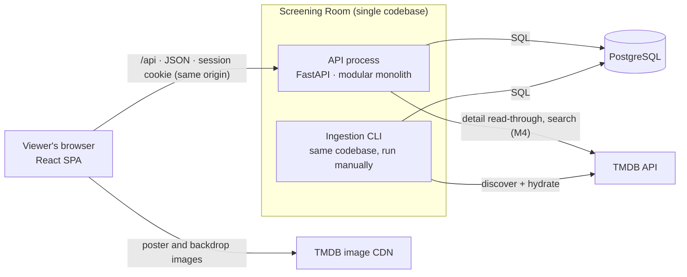
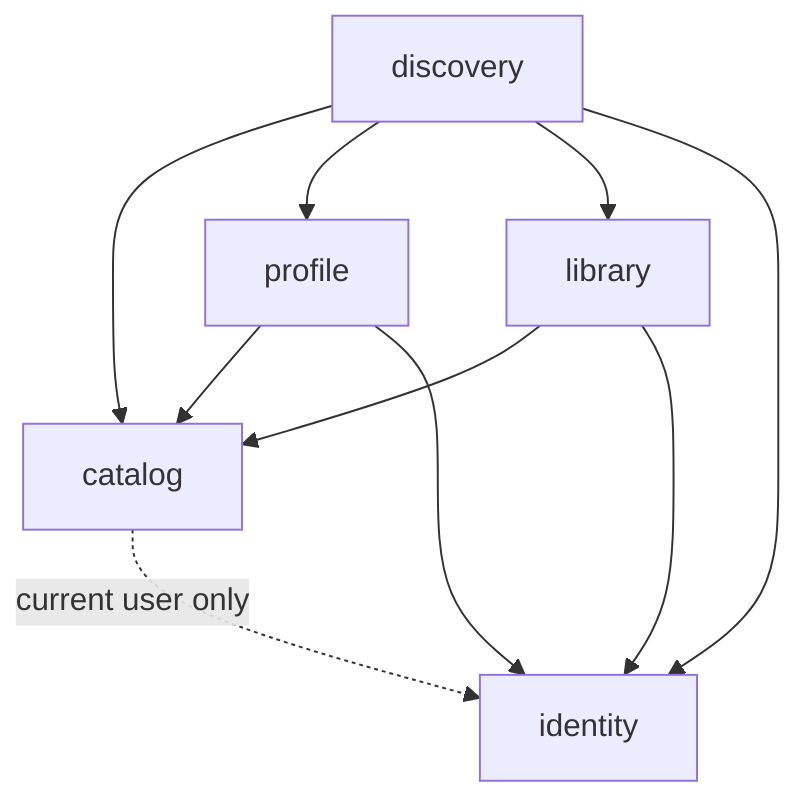

# Architecture Overview

**Status:** Draft for review · **Last updated:** 2026-10-30 · **Owner:** Project owner

## 1. Purpose and scope

Screening Room is a responsive web app that turns "What should I watch?" into a short, explained shortlist of movies and TV shows (see the [PRD](../product/PRD.md)). This document describes the system's shape: its runtime components, modules, key request paths and quality targets. The detail lives in the linked documents and ADRs.

## 2. Decision summary

| Area | Decision | Status | Reference |
|---|---|---|---|
| Architecture style | Modular monolith: one deployable, five modules with enforced boundaries | Decided | [ADR-0001](../adr/0001-modular-monolith.md) |
| Infrastructure | PostgreSQL is the only stateful dependency. No Redis, Celery or microservices in the MVP | Decided | [ADR-0002](../adr/0002-postgresql-only-infrastructure.md) |
| Recommendation data | Local seeded candidate pool (1,000–2,000 titles to start). The recommendation path never calls TMDB | Decided | [ADR-0003](../adr/0003-local-candidate-pool.md) |
| Metadata provider | TMDB behind a provider adapter, normalized internal catalog, internal genre taxonomy | Decided | [ADR-0004](../adr/0004-tmdb-provider-adapter.md) |
| Catalog population | Idempotent two-phase ingestion CLI, run manually; scheduling later | Decided | [ADR-0005](../adr/0005-catalog-ingestion-cli.md) |
| Database access | Synchronous SQLAlchemy 2.0. Handler-owned transactions. No transaction or connection held while waiting on TMDB | Decided | [ADR-0006](../adr/0006-sync-sqlalchemy-handler-owned-transactions.md) |
| Authentication | Server-side sessions in HttpOnly cookies, signed double-submit CSRF, same-origin deployment | Decided | [ADR-0007](../adr/0007-session-auth-and-csrf.md) |
| User–title state | Separate tables for watchlist, viewing events, ratings, feedback and favorites | Decided | [ADR-0008](../adr/0008-separate-user-title-relationship-tables.md) |
| Ratings | 1–5 whole stars. Separate `not_for_me` negative action | Decided | [ADR-0009](../adr/0009-ratings-and-not-for-me.md) |
| Recommendation engine | Staged, deterministic pipeline with a pure core. Explanations come only from contributing signals. v1 includes `favorite_neighbor` | Decided | [ADR-0010](../adr/0010-staged-deterministic-recommendation-pipeline.md) |
| Frontend stack | React + TypeScript + Vite, React Router, TanStack Query, OpenAPI-generated API types | Decided (conventions) | [project-structure.md](project-structure.md) |
| Styling approach | Tailwind CSS | Decided | [open-questions.md](open-questions.md) (O3) |
| Hosting target | Not chosen | Open (needed by M5) | [open-questions.md](open-questions.md) |

## 3. System context



## 4. Runtime components

| Component | Responsibility | Talks to |
|---|---|---|
| **React SPA** | All UI. Holds server state with TanStack Query. Sends the CSRF header on unsafe requests | API (same origin), TMDB image CDN |
| **API process** (FastAPI, sync handlers) | HTTP API, authentication, business rules, recommendation generation | PostgreSQL; TMDB only for detail read-through and search |
| **Ingestion CLI** (`python -m screening_room.jobs …`) | Builds and refreshes the local candidate pool: `ingest`, `refresh`, `report` | TMDB, PostgreSQL |
| **PostgreSQL** | All persistent state: users, sessions, catalog, pool, library, recommendation logs. It also acts as the metadata cache | — |
| **TMDB** (external) | Movie and TV metadata, genres, credits, per-title recommendation lists, images | — |

There's no cache server, no message broker and no worker fleet. Rationale: [ADR-0002](../adr/0002-postgresql-only-infrastructure.md).

## 5. Modules

| Module | Owns (tables) | Responsibilities | From |
|---|---|---|---|
| `identity` | `users`, `user_sessions` | Registration, login and logout, sessions, CSRF, current-user dependency, account deletion | M1 |
| `catalog` | `titles`, `genres`, `provider_genre_map`, `title_genres`, `people`, `title_credits`, `provider_title_recommendations`, `ingestion_runs`, `candidate_pool_memberships` | Provider adapter, normalization, ingestion, read-through, title detail, search | M2 |
| `profile` | `user_genre_preferences`, `user_favorite_titles` | Onboarding and taste preferences | M3 |
| `discovery` | `rec_requests`, `rec_results`, `rec_result_events` | Recommendation pipeline, logging, result-action attribution | M3 |
| `library` | `watchlist_items`, `viewing_events`, `ratings`, `title_feedback` | Watchlist, history, ratings, `not_for_me`, library views | M4 |



**Boundary rules** ([ADR-0001](../adr/0001-modular-monolith.md)):
- A module's public surface is its `service.py` functions and `schemas.py` DTOs. Its ORM models and queries are private.
- Cross-module calls are in-process function calls on that public surface, and they share the request's database session and transaction.
- `import-linter` contracts enforce the dependency graph above in CI, starting in M2.

## 6. Key request paths

### 6.1 Recommendation: `POST /api/recommendations` (local only)

1. Resolve the user's session and verify CSRF.
2. **Retrieval:** load the user's signals (preferences, favorites, and from M4 library state), the eligible candidate pool with genres, pool statistics, and the TMDB recommendation lists of the user's anchor titles, resolved to pool titles only. These are a handful of indexed queries.
3. **Pure engine:** eligibility → scoring → ranking and diversity → explanation, with an injected `as_of` date and no I/O.
4. Persist `rec_requests` and `rec_results`, commit once, return 3–5 results with reasons.

This path makes **no external calls**, which is why it carries the latency target (§7). Details: [recommendation-engine.md](recommendation-engine.md).

### 6.2 Title detail: `GET /api/titles/{id}` (local first, read-through)

The handler owns the transaction boundaries and **never holds a transaction or a checked-out connection while waiting on TMDB** ([ADR-0006](../adr/0006-sync-sqlalchemy-handler-owned-transactions.md)).

```mermaid
sequenceDiagram
    autonumber
    participant SPA
    participant H as Handler GET /api/titles/{id}
    participant DB as PostgreSQL
    participant T as TMDB
    SPA->>H: GET /api/titles/42
    H->>DB: Tx 1 (autobegun): resolve session, load title 42 → DTO
    alt full details and fresh (under TTL)
        H->>DB: end Tx 1, close session (rollback; nothing written)
        H-->>SPA: 200 {title, metadata_status: "fresh"}
    else summary-only or stale
        H->>DB: end Tx 1 (rollback) → connection returned to pool
        H->>T: GET details (credits, recommendations)
        alt TMDB succeeds
            H->>DB: Tx 2: upsert title, replace genres/credits/recommendation list, commit
            H->>DB: Tx 3: reload title → DTO
            H-->>SPA: 200 {title, metadata_status: "fresh"}
        else TMDB fails, times out or rate-limits
            H->>DB: Tx 2: record sync error, commit
            H-->>SPA: 200 {title, metadata_status: "stale" or "partial"}
        end
    end
```

A detail request never fails just because TMDB is down. If the row exists we always have at least summary data, so the response says how fresh it is. Details: [catalog-ingestion.md §11](catalog-ingestion.md#11-read-through-paths-in-the-api).

### 6.3 Search: `GET /api/search?q=` (M4)

Release the request's transaction, call TMDB search, then in a short transaction upsert the results as `summary` catalog rows (so they get stable internal IDs) and commit. Search results never enter the candidate pool by themselves.

### 6.4 Library write, e.g. "mark watched from a recommendation" (M4)

A single handler transaction: `library.mark_watched()` inserts the viewing event and removes the watchlist entry, then `discovery.record_result_event()` attributes the action to the recommendation result. One commit, in the handler. Neither service commits.

## 7. Quality attribute targets

| Attribute | Target / rule | Notes |
|---|---|---|
| **Recommendation latency** | **p95 < 1.5 s for `POST /api/recommendations`**, measured server-side with a warm local pool and an ordinary profile | Applies **only** to this endpoint, which is local-only by construction. Expected to be far lower (pool ≤ 2k titles). Baseline measured in M3, load-tested in M5 |
| Search / detail latency | No p95 target in the MVP | These depend on TMDB. Bounded by client timeouts (connect ~3 s, read ~5 s, ≤1 retry on user-facing paths). Pool titles usually come from local data |
| Reliability | A TMDB outage never makes the library, history or recommendations unavailable | Detail pages serve stale or partial data. Only search is unavailable |
| Determinism | Same profile + context + pool snapshot + engine config ⇒ same results | [ADR-0010](../adr/0010-staged-deterministic-recommendation-pipeline.md) |
| Security | Server-side authorization on every query, CSRF on every unsafe request, secrets server-side only | [security.md](security.md) |
| Privacy | Library and preferences are private. Account deletion removes all personal rows | [data-model.md §6](data-model.md#6-deletion-and-retention) |
| Data integrity | Uniqueness, ownership and referential constraints in the database. One transaction per write request | [data-model.md](data-model.md) |
| Observability | Structured JSON logs. Metrics for API errors, provider failures and retries, recommendation latency, result actions | No passwords, tokens, cookies or review text in logs |
| Accessibility | Semantic markup, keyboard navigation, labelled forms, adequate contrast | Full pass in M5. Basics from M1 |
| Portability | One documented command brings up local dependencies | Docker Compose for PostgreSQL (M1) |

## 8. Deliberately excluded from the MVP architecture

| Excluded | Why | Revisit trigger |
|---|---|---|
| Microservices | One developer, one domain, cross-module transactions | [ADR-0001](../adr/0001-modular-monolith.md) |
| Redis (cache, sessions, rate limits) | Postgres already serves as the metadata cache and session store | Multiple API instances need shared state ([ADR-0002](../adr/0002-postgresql-only-infrastructure.md)) |
| Celery / message broker | Ingestion is an idempotent CLI. No user-triggered async work in the MVP | Needing reliable async work triggered by user actions |
| ML ranking / collaborative filtering | No interaction data yet. The PRD requires explainable conventional methods | Enough users and interactions (E10 in the [enhancement ladder](recommendation-engine.md#16-enhancement-ladder)) |
| LLM-based recommendations | Out of scope per the PRD | Only ever for parsing natural-language mood into structured context (E12) |
| Full TMDB catalog mirror | Unnecessary for a curated pool, and it raises licensing questions | Coverage metrics ([catalog-ingestion.md §5](catalog-ingestion.md#5-sizing-and-growth)) |

## 9. Related documents

[project-structure.md](project-structure.md) · [data-model.md](data-model.md) · [catalog-ingestion.md](catalog-ingestion.md) · [recommendation-engine.md](recommendation-engine.md) · [security.md](security.md) · [../roadmap.md](../roadmap.md) · [future-considerations.md](future-considerations.md) · [open-questions.md](open-questions.md) · [ADR index](../adr/README.md)
