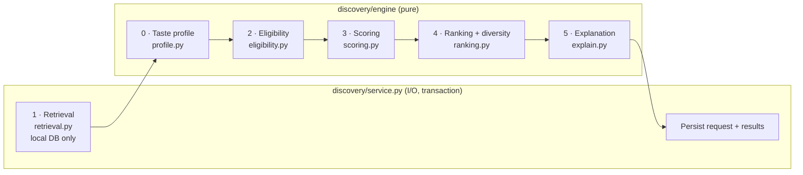

# Recommendation Engine

**Status:** Draft for review · **Last updated:** 2026-10-30
**Decision:** [ADR-0010](../adr/0010-staged-deterministic-recommendation-pipeline.md). Related: [ADR-0003](../adr/0003-local-candidate-pool.md) (local pool), [ADR-0009](../adr/0009-ratings-and-not-for-me.md) (ratings and `not_for_me`)

## 1. Goals and principles

- Return a ranked shortlist of **3–5** eligible titles (default 5) from the **local candidate pool**, based on the user's preferences, behaviour and current context (PRD FR-08, FR-09).
- **Conventional and transparent.** No ML or LLM ranking in the MVP.
- **Distinct stages:** retrieval, eligibility, scoring, ranking and explanation are separate modules with typed inputs and outputs.
- **Pure core.** Every stage after retrieval is a pure function, with no database, no clock and no randomness, so it can be tested in isolation.
- **Deterministic** for a fixed profile, context, pool snapshot and configuration.
- **Truthful explanations.** A reason exists only if the signal behind it contributed to the score (FR-10).
- **Incremental.** v1 is deliberately small, and the [enhancement ladder](#16-enhancement-ladder) lists what comes next and what evidence triggers it.

## 2. Pipeline overview



`engine/pipeline.py` composes stages 0 and 2–5:

```
recommend(signals, context, candidates, pool_stats, neighbor_index, config, as_of)
    -> RecommendationOutcome(results, rejected, cold_start, diversity_relaxed, diagnostics)
```

`rejected` lists every candidate that failed eligibility, with the rule that rejected it. That answers "why wasn't X recommended?" in tests and debugging.

The stages are **plain functions in ordered lists** (e.g. `ELIGIBILITY_RULES = [media_type_rule, runtime_rule, …]`). There's no plugin registry ([project-structure.md §10](project-structure.md#10-abstractions-deliberately-not-built-yet)).

## 3. Inputs

| Input | Contents | Source |
|---|---|---|
| `RecommendationContext` | `media_type` (`movie` / `tv` / `any`, default `any`); `genre_ids` (≤3); `max_runtime_minutes` (optional); `exclude_title_ids` (≤100); `limit` (3–5, default 5) | API request |
| `UserSignals` | Liked and avoided genres, favorites (M3). Ratings, viewing events, watchlist, `not_for_me` (M4) | profile and library services |
| `CandidateFeatures[]` | For each pool title: id, media type, genre IDs, runtime, release date, vote average and count, popularity, pool source keys | Retrieval |
| `PoolStats` | Mean vote average (C), max popularity, pool size | Retrieval (computed from the pool) |
| `NeighborIndex` | For each anchor title: its TMDB recommendation targets **resolved to pool titles**, with `provider_rank` | Retrieval |
| `EngineConfig` | Weights, thresholds, caps, priors | `engine/config.py` |
| `as_of` | Today's date, passed in by the service | Service (clock read once, outside the core) |

## 4. Stage 0: taste profile

`build_profile(signals, config)` produces:

**(a) Signed genre weights.** Each event adds its weight to every internal genre of the title (or directly to the genre, for genre preferences). The weights are summed per genre.

| Signal | Genre weight | Milestone |
|---|---|---|
| Liked genre (onboarding/preferences) | **+1.0** to that genre | M3 |
| Avoided genre | none: **hard exclusion** in eligibility | M3 |
| Favorite title | **+1.0** to each of its genres | M3 |
| Rating 5★ / 4★ / 3★ / 2★ / 1★ | **+1.0 / +0.5 / 0 / −0.5 / −1.0** | M4 |
| Watched, unrated | **+0.3** | M4 |
| On watchlist | **+0.15** (saving isn't liking) | M4 |
| `not_for_me` | **−0.3** to each of its genres. Weaker than a 2★ rating, because the user hasn't watched it, and bounded so one dismissal can't cancel a liked genre | M4 |

There's **no time decay in v1.** A new product's history is all recent, so decay would change nothing yet (E1).

**(b) Anchors** for `favorite_neighbor`:

| Anchor | Anchor weight | Milestone |
|---|---|---|
| Favorite title | 1.0 | M3 |
| Rated 5★ | 1.0 | M4 |
| Rated 4★ | 0.6 | M4 |

Anchors are capped at 30 (initial value), selected deterministically by `(anchor_weight desc, created_at desc, title_id asc)`. Low ratings aren't used as negative anchors in v1.

All values in these tables are *initial values* in `EngineConfig`.

## 5. Stage 1: retrieval

v1 retrieval is deliberately simple:

1. **Whole-pool scan.** One query loads every candidate-pool title ([data-model.md §4](data-model.md#4-the-candidate-pool-predicate)) with its genre IDs and source keys, `ORDER BY title_id`. It may pre-filter `media_type` in SQL for efficiency. With ≤2,000 titles this takes a few milliseconds.
2. **Pool statistics** come from the same data.
3. **Neighbor index.** One query joins the anchors' `provider_title_recommendations` to `titles` on `(provider, target_media_type, target_provider_id)` and **keeps only targets that satisfy the pool predicate**. Targets outside the pool are never recommended. They stay in storage for coverage metrics and future expansion.
4. **User signals** come from the profile service (and, from M4, the library service), returned as DTOs.

Retrieval stays a whole-pool scan until the pool exceeds roughly 20k titles or latency is at risk (E8).

## 6. Stage 2: eligibility

Each rule is a pure function returning `Keep` or `Reject(rule, detail)`. **Eligibility re-checks everything**, even rules that retrieval pre-filtered, so the core's guarantees don't depend on SQL.

| Rule | Excludes a candidate when… | Milestone |
|---|---|---|
| `media_type` | Context type is `movie` or `tv` and the title differs | M3 |
| `context_genres` | Context `genre_ids` are set and the title has none of them | M3 |
| `max_runtime` | Movie with `runtime_minutes` > max, **or unknown runtime while a max is set**. TV isn't affected in v1, and the UI says so | M3 |
| `avoided_genre` | Title has any genre the user avoids | M3 |
| `favorite` | Title is one of the user's favorites | M3 |
| `explicit_exclusion` | Title is in `exclude_title_ids` (skip / "show me more") | M3 |
| `unreleased` | `release_date` is null or after `as_of` | M3 |
| `pool_status` | Not `full`, not `active`, or `adult` (defence in depth) | M3 |
| `watched_or_rated` | User has a viewing event or rating for the title | M4 |
| `not_for_me` | User marked the title `not_for_me` | M4 |

Deferred: a "revisit watched titles" context option, and persisted `not_now` cooldowns (E6).

## 7. Stage 3: scoring

```
score = 0.45 · affinity + 0.25 · favorite_neighbor + 0.20 · quality + 0.10 · popularity
```
The weights are *initial values*, tuned with the fixtures (§14).

| Signal | Range | Definition |
|---|---|---|
| `affinity` | [−1, 1] | Cosine similarity between the title's genre indicator vector and the user's signed genre-weight vector. 0 when the user has no non-zero weights |
| `favorite_neighbor` | [0, 1] | See below |
| `quality` | [0, 1] | Bayesian average ÷ 10: `(v/(v+m))·R + (m/(v+m))·C`, where R = vote_average, v = vote_count, C = pool mean, m = 500 (*initial value*) |
| `popularity` | [0, 1] | `log1p(popularity) / log1p(pool_max_popularity)`. A tie-breaker-scale weight, never the main personalization mechanism |

### 7.1 `favorite_neighbor`: a supporting, title-level signal

- **What it means:** the candidate appears in TMDB's recommendation list for one of the user's anchor titles (favorites in M3, plus 4–5★ ratings in M4).
- **Value:** the maximum over anchors `a` whose resolved list contains the candidate of `anchor_weight(a) × (1 − (provider_rank − 1) / 20)`. So rank 1 from a favorite gives 1.0, and rank 20 gives 0.05.
- **Tie-break for the recorded anchor:** higher value, then lower `provider_rank`, then lower anchor `title_id`.
- **Supporting, not the whole strategy:**
  - It carries 0.25 of the weight. Affinity, quality and popularity are always computed for every candidate.
  - Neighbors get no separate retrieval path that bypasses eligibility or diversity. They're ordinary pool candidates with one more signal.
- **Graceful fallback:** if a favorite has no stored list, its list is empty, or none of its targets resolve to eligible pool titles, that anchor contributes nothing. Candidates are then scored by affinity, quality and popularity, as they would be for a user with no favorites. Nothing fails, and no neighbor reason is emitted. The request logs `anchor_count` and `anchors_without_neighbors`.
- **Source preserved:** each result's `score_breakdown.favorite_neighbor` records `{value, weighted, anchor_title_id, anchor_kind, provider: "tmdb", provider_rank}`. The stored relationship keeps `provider`, `provider_rank`, `fetched_at` and `ingestion_run_id` ([data-model.md §3.2](data-model.md#32-catalog-m2)).
- **Honest interpretation:** TMDB doesn't publish how its recommendation lists are built, so we never claim *why* the titles are related (§9).

## 8. Stage 4: ranking and diversity

1. Sort the eligible candidates by `(-round(score, 6), title_id)`.
2. Fill `limit` slots greedily in that order, skipping a candidate that would break a diversity rule:
   - **(a) Genre spread, counting all genres:** no internal genre may appear in more than **3** of the 5 results. Each title counts toward **every** genre it has, so there's no single "primary" genre and no reliance on TMDB's genre order. Genres the user explicitly selected in `context.genre_ids` are exempt, because the user asked for them.
   - **(b) Near-duplicate guard:** at most **1** result per identical genre set.
3. If the rules leave slots empty after one pass, fill them from the skipped candidates in score order, and set `diversity_relaxed = true` on the request.

Both caps are *initial values* in `EngineConfig`. This is a simple, explainable spread rule. Similarity-aware re-ranking (MMR) and franchise caps come with E4, once a real similarity measure exists.

## 9. Stage 5: explanations

Each signal produces structured reason candidates alongside its value. `explain` picks **up to 2** reasons per result, and **at least 1** is guaranteed:

| Reason type | Emitted when | Display text (template) |
|---|---|---|
| `favorite_neighbor` | Weighted contribution ≥ 0.08 | "Because you picked *{anchor}*". M4 rating anchors: "Because you rated *{anchor}* {n}★" |
| `genre_affinity` | Weighted contribution ≥ 0.10 and the title shares ≥1 genre with positive user weight | "Matches genres you like: {g1}, {g2}" (top 2 by user weight) |
| `context_genre` | `context.genre_ids` set | "Matches your pick: {genre}" |
| `runtime_fit` | `max_runtime_minutes` set and the title is a movie | "Fits your time: {1h 42m}" |
| `well_rated` | `quality` ≥ 0.75 | "Rated {7.9}/10 by {12,400} TMDB users" |
| `pool_source` | Fallback, always available | From the title's membership source, e.g. "Among TMDB's top-rated movies" or "Popular on TMDB" |

**Selection:** first the highest-contributing *personal* reason (`favorite_neighbor` or `genre_affinity`), then one *context* or *quality* reason (`context_genre`, `runtime_fit`, `well_rated`). If no personal reason qualifies, show up to 2 non-personal reasons. If nothing qualifies, show `pool_source`.

**Truthfulness rules:**
- A reason may only state facts present in the inputs. "Because you picked *Arrival*" is true: the user picked it, and the system used that link. We never say "similar tone", "same director" or anything else we haven't computed.
- Thresholds are *initial values*. A tested invariant requires every personal reason to correspond to a non-zero contribution in `score_breakdown`.

The API returns reasons as structured objects (`type`, params, `text`). The text is rendered server-side so there's one source of truth.

## 10. Cold start and fallbacks

- **Cold start** is when the user has no liked genres, no favorites and (M4) no library signals. Then affinity and `favorite_neighbor` are 0 for everyone, and ranking comes from quality and popularity within the context filters, with the diversity rules applied. The response sets `cold_start: true` and the UI shows "Recommendations improve as you pick favorites, rate and dismiss titles."
- **Too few eligible candidates:** return what's eligible (possibly fewer than 3), plus a notice suggesting the user relax a filter (e.g. "No movies under 80 minutes match. Try a longer runtime."). Never pad the list with ineligible titles.
- **No neighbors available:** covered in §7.1. It's invisible to the user apart from the missing reason.

## 11. Determinism

| Rule | Implementation |
|---|---|
| No hidden inputs | `as_of` is passed in. No `datetime.now()`, randomness or environment reads inside `engine/` (a test checks the imports) |
| Stable ordering | Retrieval queries end with `ORDER BY … title_id`. Sorting uses rounded scores with a `title_id` tiebreak. The anchor and reason tie-breaks are defined |
| Order-independence | A test shuffles the candidate, anchor and signal input order and asserts identical output |
| Recorded inputs | Each request stores `engine_version`, `config_hash`, `pool_size` and the context |
| Scope | Determinism is promised for a **fixed dataset**. Ingestion runs change the pool and recommendation lists by design, and those are the "documented external metadata updates" PRD §16 allows for |

## 12. Configuration and versioning

- `EngineConfig` (a Pydantic model in `engine/config.py`) holds every weight, threshold, cap and prior in this document, in one place. No module hard-codes them.
- `ENGINE_VERSION` is bumped whenever scoring behaviour changes intentionally. Golden-test expectations are updated in the same commit, so behaviour changes are always reviewed.
- `config_hash` (a hash of the serialized config) is stored on every request, which makes logged results reproducible.

## 13. Logging and evaluation data

| Stored | Enables |
|---|---|
| `rec_requests` (context, counts, cold_start, diversity_relaxed, anchor stats, latency, version, hash) | Latency tracking, coverage (how often there are < 5 results), cold-start share, neighbor coverage |
| `rec_results` (rank, score, `score_breakdown`, reasons) | Explaining any past result. Comparing signals offline |
| `rec_result_events` (M4: opened, saved, watched, rated, not_for_me, skipped) | Action rate, dismissal rate, positive-outcome rate (PRD §12), **broken down by top-contributing signal**, e.g. whether `favorite_neighbor`-led results get saved more often than affinity-led ones |

Clicks aren't treated as success on their own. The primary quality evidence is saves, watches with positive ratings, and `not_for_me` rates (PRD §12).

## 14. Testing strategy

| Layer | What |
|---|---|
| Fixture catalog | ~150 hand-built titles across genres, decades, languages and both media types, **including recommendation lists**: some resolve to the pool, some don't, some are empty |
| Personas | New user (cold start) · sci-fi fan with favorites whose lists resolve · "comedy movie under 90 min" · TV-only drama fan · horror avoider · user whose favorites have **no** usable neighbors (fallback) · M4: user with ratings and `not_for_me` |
| Invariants (every persona) | No ineligible title returned · ≤ `limit` results · ≥1 reason each · every personal reason matches a non-zero contribution · diversity rules hold unless `diversity_relaxed` · output identical under input shuffling |
| Golden tests | The expected top results for each persona, checked into the repo and updated only with an `ENGINE_VERSION` bump |
| Unit tests | Each rule, signal and the profile builder in isolation (e.g. a `not_for_me` title is excluded *and* lowers its genres' weights) |
| Integration | `POST /api/recommendations` against PostgreSQL: retrieval queries, the pool-only neighbor resolution, persistence, the single commit |

## 15. Performance and API

**Budget.** p95 < 1.5 s for `POST /api/recommendations` ([overview §7](overview.md#7-quality-attribute-targets)). Expected cost with ≤2,000 pool titles:
- retrieval: a few small indexed queries
- scoring: ~2k candidates × ≤30 anchors as dictionary lookups, a few milliseconds in Python
- persistence: a handful of inserts

A baseline is measured in M3, and a load test runs in M5.

**API sketch.** POST, because each call creates a logged request. It needs CSRF.

```json
// POST /api/recommendations
{ "media_type": "movie", "genre_ids": [7], "max_runtime_minutes": 110, "exclude_title_ids": [981] }

// 200
{
  "request_id": 812,
  "cold_start": false,
  "notices": [],
  "results": [
    {
      "result_id": 4410,
      "rank": 1,
      "title": { "id": 233, "media_type": "movie", "name": "…", "year": 2016,
                 "poster_path": "/….jpg", "overview": "…", "runtime_minutes": 116 },
      "reasons": [
        { "type": "favorite_neighbor", "anchor_title_id": 17, "text": "Because you picked Arrival" },
        { "type": "runtime_fit", "text": "Fits your time: 1h 56m" }
      ]
    }
  ]
}
```

## 16. Enhancement ladder

These are **Deferred** and not part of the MVP. They're ordered roughly by expected value per effort, and each one starts only when its trigger is met.

| ID | Enhancement | Why | Prerequisite | Trigger |
|---|---|---|---|---|
| E1 | Time decay on behavioural signals (half-life, with onboarding not decayed) | Let recent taste matter more | Months of history | Users with > 3 months of activity |
| E2 | Content similarity (keywords, directors and creators, cast) | Our own explainable "similar to" signal, e.g. "same director" | `keywords` tables, richer hydration | Neighbor coverage is low, or reasons feel generic |
| E3 | Curated mood presets mapped to genres and keywords as soft boosts | PRD "mood" without pretending mood is metadata | E2 keywords helpful | Usability tests show genre direction isn't enough |
| E4 | MMR diversity + franchise cap | Better spread than genre caps | A similarity measure (E2), `collections` | Near-duplicates observed despite the caps |
| E5 | Impression fatigue (down-rank titles shown repeatedly without action) | PRD: avoid repetitive recommendations | `rec_results` history | Repeat-exposure rate is measurable and high |
| E6 | Persisted `not_now` with a cooldown | "Not tonight" that sticks | `title_feedback.kind` widened | User feedback |
| E7 | Genre IDF weighting; per-user rating mean-centering | Stop broad genres (Drama) dominating. Account for harsh or generous raters | Rating data | Affinity skew visible in evaluation |
| E8 | Multi-source retrieval with SQL pre-filtering | Scale beyond a whole-pool scan | — | Pool > ~20k or latency budget at risk |
| E9 | Pool expansion from anchors' unresolved neighbors and users' titles | Better coverage where users actually are | Ingestion support | Coverage triggers ([catalog-ingestion.md §5](catalog-ingestion.md#5-sizing-and-growth)) |
| E10 | Implicit-feedback collaborative filtering (e.g. ALS) | Learn from other users | Hundreds of active users with enough interactions | Offline evaluation shows lift over v1 |
| E11 | Learning-to-rank on logged breakdowns and outcomes | Data-driven weights | Outcome data at volume | E10-scale data |
| E12 | LLM to parse natural-language mood into `RecommendationContext` (never to rank) | Friendlier input | Stable context schema | Product decision |
