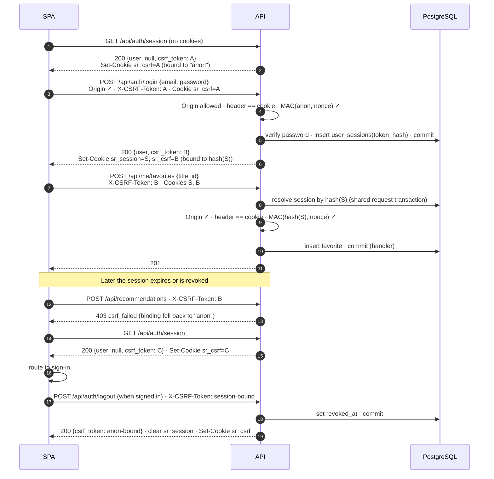

# Security: Authentication, Sessions, CSRF, Authorization

**Status:** Draft for review · **Last updated:** 2026-10-30
**Decision:** [ADR-0007](../adr/0007-session-auth-and-csrf.md). Related: [ADR-0006](../adr/0006-sync-sqlalchemy-handler-owned-transactions.md) (shared request session)

## 1. Scope and threat summary

The MVP has email-and-password accounts holding private viewing data. The threats this design addresses:

| Threat | Main mitigation |
|---|---|
| Session theft via XSS | HttpOnly session cookie; no tokens in `localStorage`; React's default escaping; a CSP in M5 |
| Cross-site request forgery, including login CSRF | SameSite=Lax + Origin check + signed double-submit CSRF token (§5) |
| Cookie tossing from a sibling subdomain | `__Host-` cookie prefixes in production |
| Accessing another user's data (IDOR) | `/api/me/...` routes scoped to the session's user; every query filtered by `user_id` (§6) |
| Password guessing | Argon2id hashing; generic errors; login rate limiting before public deployment (M5) |
| Secret leakage | TMDB token and CSRF secret are server-side env settings, never logged and never sent to the browser |
| Database session or token leak | Only SHA-256 hashes of session tokens are stored |

## 2. Passwords

- Hashed with **Argon2id** using the library's current recommended parameters. Hashes are rehashed on successful login if the parameters change.
- Initial policy: minimum 10 characters, maximum 128, no composition rules (in line with current NIST guidance). A breached-password check is deferred.
- Registration and login return generic errors ("Invalid email or password"). Registering an email that already exists returns a generic conflict message.

## 3. Sessions

| Aspect | Rule |
|---|---|
| Token | 256-bit random value from a CSPRNG, base64url-encoded |
| Storage | `user_sessions.token_hash = SHA-256(token)`. The raw token exists only in the cookie |
| Lifetime | **Absolute 30 days** (*initial value*) from creation. **No sliding expiry and no `last_seen_at` updates in the MVP**, so the auth check is read-only ([ADR-0006](../adr/0006-sync-sqlalchemy-handler-owned-transactions.md)) |
| Validation | Look up by hash. It must exist, have `revoked_at IS NULL`, and have `expires_at > now()`. This runs inside the request's shared session and transaction |
| Login | Always creates a **new** session. If the request carried an old session cookie, that session is revoked (session-fixation hygiene) |
| Logout | Sets `revoked_at`, clears the cookie, issues an anonymous CSRF token |
| Account deletion | All sessions are deleted by cascade |
| Data minimization | No IP address or user agent stored |

### Cookies

| Cookie (production name) | Purpose | HttpOnly | Secure | SameSite | Path | Lifetime |
|---|---|---|---|---|---|---|
| `__Host-sr_session` | Session token | **Yes** | Yes | Lax | `/` | `Max-Age` = remaining session lifetime |
| `__Host-sr_csrf` | CSRF token (double-submit copy) | No | Yes | Lax | `/` | Same as the session if authenticated. Browser-session cookie if anonymous |

`__Host-` requires `Secure`, `Path=/` and no `Domain`, which blocks subdomains from setting these cookies. For local development over `http://localhost`, the names (`sr_session`, `sr_csrf`) and the `Secure` flag are configurable (`COOKIE_PREFIX_HOST`, `COOKIE_SECURE`).

## 4. Same-origin deployment

The SPA and API share one origin. In development, Vite proxies `/api` to FastAPI. In production, a single host serves both. With no CORS configuration, cross-origin JavaScript can't read API responses, and SameSite cookies behave predictably.

## 5. CSRF protection

### 5.1 Mechanism: signed double-submit token, bound to the session

This follows OWASP's recommended *signed double-submit cookie* pattern. No CSRF state is stored in the database.

```
token   = nonce "." mac
nonce   = 128-bit random, base64url
mac     = base64url( HMAC-SHA256( CSRF_SECRET, binding || "|" || nonce ) )
binding = "anon"                         when the request has no valid session
        = hex(session.token_hash)        when the request has a valid session
```

Binding the token to the session's token hash means a token minted for one session (for example, one an attacker obtained for their own account) is useless against any other session.

### 5.2 Bootstrap: how the SPA gets its first token

1. On startup, the SPA calls **`GET /api/auth/session`**.
2. The server resolves the session (if any), computes the current binding, and checks the `sr_csrf` cookie:
   - If it's present and its MAC verifies for the current binding, it's reused.
   - Otherwise a new token is minted for the current binding and set in the `sr_csrf` cookie.
3. The response body is `{ "user": null | {...}, "csrf_token": "<token>" }`.
4. The SPA keeps the token **in memory** and sends it as **`X-CSRF-Token`** on every POST, PUT, PATCH and DELETE. The browser sends the cookie copy automatically.

An unauthenticated visitor therefore always has a valid **anonymous** token before they can register or log in.

### 5.3 Validation: every unsafe request (POST / PUT / PATCH / DELETE under `/api`)

Implemented once, as middleware or a router-level dependency, in `identity/csrf.py`:

1. **Origin check:** the `Origin` header must be in `ALLOWED_ORIGINS`. If `Origin` is absent, the `Referer` origin is used. If both are absent, reject with **403 `origin_rejected`**.
2. **Resolve the session** from the session cookie (read-only, in the request's shared session) to get the binding.
3. **Double-submit:** the `X-CSRF-Token` header and the `sr_csrf` cookie must both be present and equal (constant-time comparison).
4. **Signature:** recompute the MAC for the current binding and compare in constant time. A mismatch is **403 `csrf_failed`**.
5. Only then does route-level authentication run: a protected route without a valid session gets **401 `unauthenticated`**.

Safe methods (GET, HEAD, OPTIONS) skip CSRF and must not change user state. The only server writes on GET are catalog cache fills and CSRF cookie issuance.

### 5.4 Register and login (unauthenticated, unsafe)

- **Require a valid anonymous-bound token plus the Origin check.** Together these prevent **login CSRF**, where an attacker silently logs the victim into the attacker's account so the victim's activity is recorded there.
- Honest limit: an attacker can obtain *their own* valid anonymous token. What stops them using it against a victim: they can't plant that token in the victim's cookie jar (the `__Host-` prefix blocks subdomain cookie tossing). Their page also can't send a cross-origin request carrying a custom `X-CSRF-Token` header, because that triggers a CORS preflight, which our API never approves. The Origin check is the primary defence for these two endpoints, and the token adds defence in depth.
- **On success:** create the session, then **rotate** the CSRF token to one bound to the new session. The response sets both cookies and returns `{ user, csrf_token }`. The SPA replaces its in-memory token.

### 5.5 Lifecycle



### 5.6 Client behaviour on CSRF failure

When the API client receives `403 csrf_failed`, it calls `GET /api/auth/session` **once**:
- If the user is still signed in, it retries the original request once with the new token. This is safe, because the rejected request was never processed.
- If the user isn't signed in, it routes to sign-in.

`origin_rejected` is never retried.

### 5.7 Secret rotation

Rotating `CSRF_SECRET` invalidates all outstanding CSRF tokens. The next unsafe request fails with `csrf_failed`, the SPA re-bootstraps (§5.6), and work continues. Sessions aren't affected.

## 6. Authorization and account actions

- User-owned resources are only reachable under `/api/me/...`. The user ID always comes from the session, never from the request.
- Every service function that reads or writes user-owned rows takes `user_id` explicitly and filters by it. Integration tests check that user A can't read or modify user B's rows through any endpoint.
- Catalog and title endpoints are readable by any signed-in user, and the private library data overlaid on them comes only from the caller's own rows.
- **Account deletion (M4)**, `DELETE /api/me`: requires a session-bound CSRF token **and re-entry of the current password**. It cascades all personal data ([data-model.md §6](data-model.md#6-deletion-and-retention)) and clears cookies.

## 7. Input validation, errors and headers

- Pydantic validates every request body and query parameter, with explicit bounds (string lengths, list sizes such as `exclude_title_ids ≤ 100`, `genre_ids ≤ 3`).
- Mutations accept `application/json` only, which also blocks form-based CSRF payloads.
- Errors use the standard error body. No stack traces or SQL in responses.
- SQL goes only through SQLAlchemy expressions or bound parameters.
- **M5 hardening:** HSTS, a Content-Security-Policy (with TMDB's image CDN allowed for `img-src`), `X-Content-Type-Options`, `Referrer-Policy`, `frame-ancestors 'none'`. *Implemented in M5a* (`core/headers.py`), plus `X-Frame-Options`, `Cross-Origin-Opener-Policy` and `Permissions-Policy`. HSTS only over HTTPS. The API docs page is exempt from the CSP and is turned off in production.

## 8. Rate limiting

**Login and registration rate limiting is required before public deployment (M5).** The initial approach is a fixed window per IP and per email address. With a single API instance it can be in-process, and it moves to PostgreSQL or Redis only if multiple instances need shared state ([ADR-0002](../adr/0002-postgresql-only-infrastructure.md)).

*Implemented in M5a* (initial values, in settings): login 30 attempts per IP per 15 minutes; login **failures** per email 10 per 15 minutes (successful logins don't count, so nobody can lock a user out by trying their address); registration 10 per IP per hour. Over the limit: `429 rate_limited` with `Retry-After`.

## 9. Logging hygiene

Never logged: passwords, session or CSRF tokens, cookies, the `Authorization` header, the TMDB token, or review text. User IDs may appear in logs. Email addresses only at debug level and never in production.

## 10. Deferred

| Item | Trigger |
|---|---|
| Password reset by email | Needs email infrastructure. Required before inviting non-test users at scale |
| Email verification | Same |
| Sliding or idle session timeout, "active sessions" list | User demand. It would need throttled writes outside the read path |
| MFA, OAuth/social login | Product decision |
| Breached-password check | Before public launch, if feasible |
